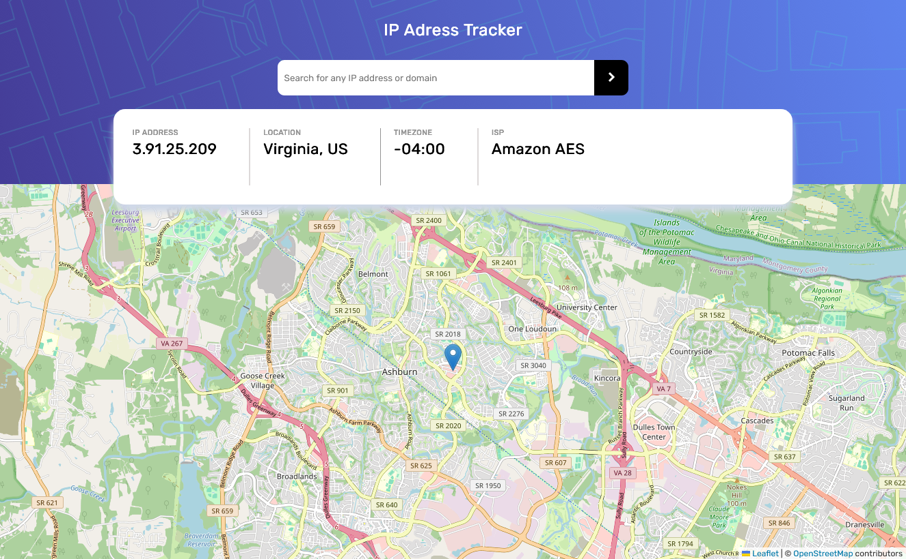

# Frontend Mentor - IP address tracker solution

This is a solution to the [IP address tracker challenge on Frontend Mentor](https://www.frontendmentor.io/challenges/ip-address-tracker-I8-0yYAH0). Frontend Mentor challenges help you improve your coding skills by building realistic projects. 

## Table of contents

- [Overview](#overview)
  - [The challenge](#the-challenge)
  - [Screenshot](#screenshot)
  - [Links](#links)
- [My process](#my-process)
  - [Built with](#built-with)
  - [What I learned](#what-i-learned)
  - [Useful resources](#useful-resources)
- [Author](#author)
- [Acknowledgments](#acknowledgments)

## Overview

### The challenge

Users should be able to:

- View the optimal layout for each page depending on their device's screen size
- See hover states for all interactive elements on the page
- See their own IP address on the map on the initial page load
- Search for any IP addresses or domains and see the key information and location

### Screenshot

### Links

- Live Site URL: [IP Tracker Vercel Deployment](https://ip-tracker-client-ten.vercel.app/)

## My process

### Built with

- Semantic HTML5 markup
- CSS custom properties
- Mobile-first workflow
- [React](https://reactjs.org/) - JS library
- Node.js 

### What I learned

Oh boy! I learned a lot while doing this project. I was already familiar with SPA-based architectures thanks to my previous ASP.Net Blazor project, but I found React to be a lot more of a complex beast. Thanks to NetNinjas React course and the helpful React subreddit, I was able to pull through and learned a lot about states, the useEffect hook, and good React principles.

Also learned how to proxy an API call through a backend using Node.JS. This part was particularly challenging as I had to learn the basics of Node and Express at the same time, while not trying not consume more time as I had already spent so much on learning React. Some new concepts that particularly stuck out to me were all the ways you can perform a fetch in node. I used needle for this project. I still have more to learn about Node but I feel thoroughly comfortable with using React and Blazor in the future.

### Useful resources

- NetNinja's React.JS course - This helped me go through the basics
- Traversy Media - Learned the basics of Node and Express from him. Also found out how to perform a fetch request in the backend using needle and how to build an API proxy.
- React.JS and Web Development subreddits - These guys helped me a ton through this one. Could not have done it without them.

## Author

- Frontend Mentor - [@ginikaifeanyi88-web](https://www.frontendmentor.io/profile/ginikaifeanyi88-web)
- Leetcode - [Ika_Chow](https://leetcode.com/u/Ika_Chow/)
